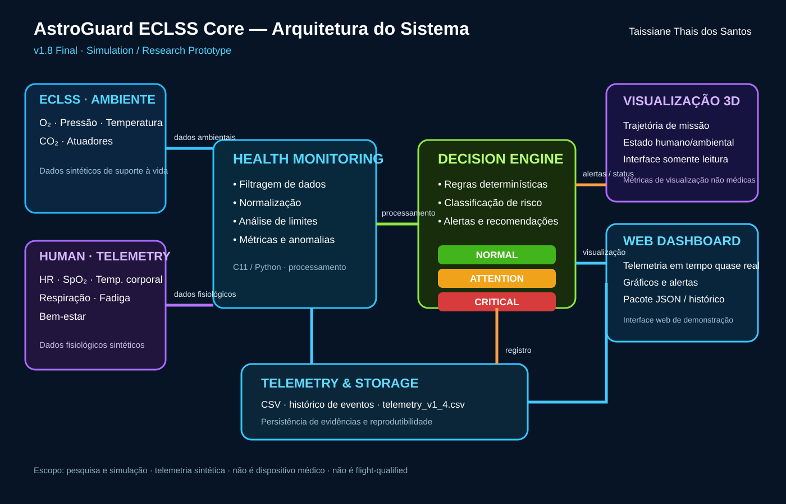

# AstroGuard v1.8 — Official System Architecture

**Developer:** Taissiane Thais dos Santos  
**Version:** v1.8 Final  
**Classification:** Simulation / Research Prototype

## Purpose

This document is the repository-level architecture reference for AstroGuard ECLSS Core. It defines how synthetic environmental telemetry and synthetic human telemetry flow through deterministic processing, health-state classification, telemetry storage, 3D visualization and the web dashboard.

## Data flow

`Environment telemetry` + `Human telemetry`  
→ `Health Monitoring`  
→ `Decision Engine`  
→ `NORMAL / ATTENTION / CRITICAL`  
→ `Telemetry & Storage`  
→ `3D Visualization / Web Dashboard`

## Components

| Layer | Responsibility | Status |
|---|---|---|
| ECLSS Environment | O2, pressure, temperature and actuator simulation | IMPLEMENTED / SIMULATED |
| Human Telemetry | HR, SpO2, body temperature, respiration, fatigue and well-being | IMPLEMENTED / SIMULATED |
| Health Monitoring | Filtering, normalization, limit analysis and anomaly detection | IMPLEMENTED |
| Decision Engine | Deterministic health-state evaluation and alerts | IMPLEMENTED |
| Telemetry & Storage | CSV telemetry and reproducible evidence | IMPLEMENTED |
| 3D Visualization | Mission trajectory and read-only telemetry presentation | IMPLEMENTED |
| Web Dashboard | Browser-based mission monitoring interface | IMPLEMENTED |
| Operational control | Commands to a real spacecraft | NOT IMPLEMENTED |

## Version evolution

- **v1.3:** ECLSS environmental simulation
- **v1.4:** Human Health Monitoring
- **v1.5:** 3D mission visualization
- **v1.6:** Web mission dashboard
- **v1.7:** Demonstration video specification
- **v1.8:** Final documentation and presentation
- **v1.9:** Advanced Mission Health Analytics — FUTURE

## Scientific boundary

All human physiological values and mission scenarios are synthetic. Visualization-derived stress representations are software visualization metrics, not medical scores. The project is not presented as a medical device, clinical decision system, flight-qualified software package or operational spacecraft-control system.

## Traceability

The architecture is aligned with the v1.8 final technical documentation, audit report, telemetry protocol, CI workflow and presentation source tracked in this repository.
